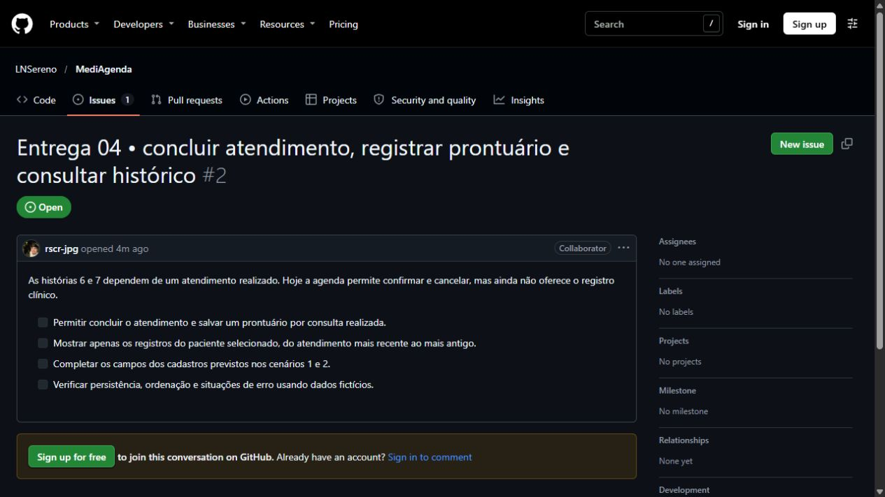

<p align="center">
  
</p>

<h1 align="center">MediAgenda</h1>

## Sobre o Projeto

MediAgenda é uma aplicação web para gerenciamento de consultório médico, que permite o cadastro de pacientes e médicos, o agendamento e acompanhamento de consultas, e o registro de prontuários.

O sistema busca facilitar a rotina administrativa de clínicas de pequeno e médio porte, reduzindo conflitos de agenda, centralizando o histórico clínico dos pacientes e dando visibilidade rápida da agenda diária de cada médico.

## Tecnologias e ferramentas

- Java, Spring Boot, Spring Data JPA
- Thymeleaf, HTML5 e CSS3
- H2 (banco local para desenvolvimento)

## Equipe
| Nome | email |
| --- | --- |
| Henrique Neves Pontual | hnp@cesar.school |
| Lucas Nery Sereno |  lns3@cesar.school |
| Pedro Freitas Lustosa de Caravalho | pflc@cesar.school |
| Rubens Sousa Carvalho da Rocha | rscr@cesar.school |

## Alterações na equipe

Não houve entrada ou saída de integrantes registrada até esta entrega.

| Membro | E-mail CESAR School | Entrada | Saída |
| --- | --- | --- | --- |
| Nenhuma alteração registrada | - | - | - |

## Entrega 1

- [Histórias em BDD](./Histórias_BDD.md)
- [Protótipo Lo-Fi (Figma)](https://www.figma.com/design/UEResJqM7OeZHOcTmodCFX/MediAgenda---Prot%C3%B3tipo-Lo-Fi?node-id=3-46&p=f&t=iy5O8tKdYP0rVKmC-0)
- [Screencast (YouTube)](https://youtu.be/cMknoEeaaEY)

## Entrega 02

Esta etapa não foi implementada pela equipe. A base necessária para as histórias da Entrega 03 foi incluída nesta branch, sem criar evidências retroativas.

## Entrega 03

### Histórias implementadas (formato POST-IT)

> **História 4 - Cancelamento de consulta**
>
> **Como** paciente, **quero** cancelar uma consulta agendada e informar o motivo, **para** liberar o horário caso eu não possa comparecer.
>
> **Pronto quando:** a consulta muda para `CANCELADA`, o motivo fica persistido e o horário pode ser usado novamente pelo mesmo médico.

> **História 5 - Confirmação de consulta**
>
> **Como** paciente, **quero** confirmar minha presença em uma consulta agendada, **para** que a clínica saiba que devo comparecer.
>
> **Pronto quando:** uma consulta `AGENDADA` muda para `CONFIRMADA` e o novo status permanece salvo ao recarregar a página.

### O que foi desenvolvido

- Aplicação Spring Boot com interface web em Thymeleaf.
- Persistência JPA de pacientes, médicos e consultas (três entidades de domínio), usando H2 local.
- Cadastro dos dados mínimos que sustentam a agenda e bloqueio de conflito de horário do médico.
- Confirmação de presença e cancelamento com motivo persistido.
- Testes unitários das regras principais de agenda.
- Sem Lombok ou outro gerador de código boilerplate.

### Como rodar

Pré-requisito: Java 17 e Maven 3.9 ou superior.

```bash
mvn spring-boot:run
```

Abra [http://localhost:8080](http://localhost:8080). Os dados ficam em `data/mediagenda` e são preservados entre execuções locais. Para executar os testes:

```bash
mvn test
```

### Evidências a serem incluídas pela equipe

- Vídeo do sistema: **pendente** - grave seguindo as [instruções](docs/entrega-03/COMPLEMENTOS_MANUAIS.md) e substitua este marcador pelo link real do YouTube.
- Vídeo explicando o código: **pendente** - grave seguindo as [instruções](docs/entrega-03/COMPLEMENTOS_MANUAIS.md) e substitua este marcador pelo link real do YouTube.
- Issues do GitHub: nenhuma issue existia no repositório na análise. Crie/atualize issues reais, capture a tela e salve-a como `docs/entrega-03/evidencias/issues-entrega-03.png`; então troque este texto pela imagem real.

## Entrega 04

### Histórias implementadas

**6 · Registro de prontuário após consulta**

> Como médico, quero registrar diagnóstico e prescrição após atender um paciente, para manter o histórico clínico atualizado.

Na agenda, conclua o atendimento e abra **Prontuário**. O formulário identifica o paciente, o médico e a data da consulta. Ao salvar o diagnóstico, a prescrição e as observações opcionais, o sistema abre o histórico daquele paciente. Cada consulta realizada admite um registro.

**7 · Consulta ao histórico do paciente**

> Como médico, quero visualizar o histórico de prontuários de um paciente, para ter contexto sobre atendimentos anteriores.

Na lista **Pacientes**, abra o nome desejado. Os prontuários aparecem pela data do atendimento, do mais recente ao mais antigo. Quando o paciente ainda não tem registros, a página informa isso.

### Cenários de validação

| Dado | Quando | Então |
| --- | --- | --- |
| Uma consulta realizada | O médico salva diagnóstico, prescrição e observações | O prontuário fica associado à consulta e aparece no histórico do paciente |
| Uma consulta ainda agendada | Há uma tentativa de registrar o prontuário | O registro é recusado |
| Uma consulta já tem prontuário | O médico abre novamente o prontuário pela agenda | O sistema abre o histórico com o registro salvo |
| Um paciente tem três prontuários e outro tem um | O médico abre o perfil do primeiro paciente | Aparecem apenas os três atendimentos dele, em ordem decrescente de data |

Os cadastros desta versão também contemplam a data de nascimento do paciente e os contatos do médico previstos na entrega 1. A especialidade pode ser selecionada no formulário.

[Histórias e cenários originais](./Histórias_BDD.md) · [Testes das regras de prontuário e histórico](./src/test/java/br/com/mediagenda/ClinicalHistoryTest.java) · [Teste do fluxo web](./src/test/java/br/com/mediagenda/ClinicalWebTest.java)

### Acompanhamento no GitHub

[Issue #2 — registro de prontuário e histórico](https://github.com/LNSereno/MediAgenda/issues/2)



### Vídeos da entrega

A publicação dos dois screencasts no YouTube está pendente.
