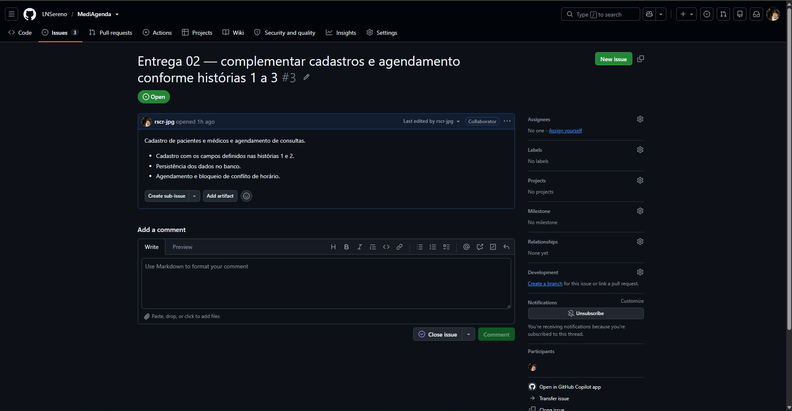
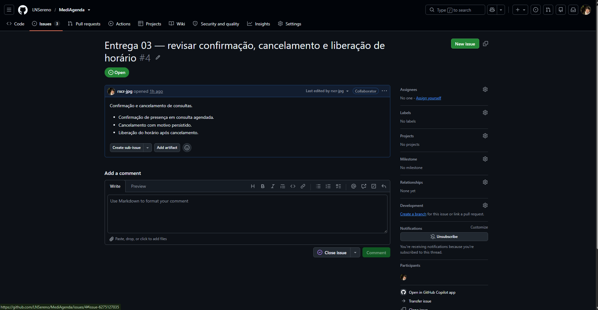
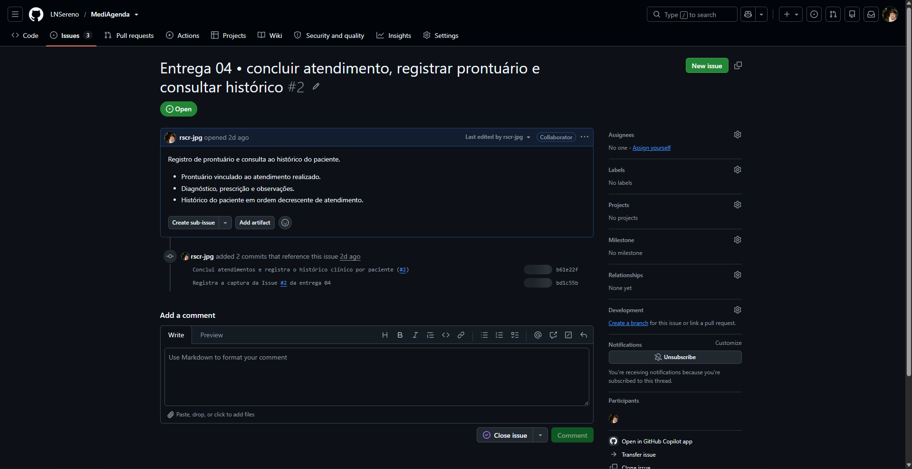

<p align="center">
  
</p>

<h1 align="center">MediAgenda</h1>

## Sobre o Projeto

MediAgenda é uma aplicação web para gerenciamento de consultório médico, que permite o cadastro de pacientes e médicos, o agendamento e acompanhamento de consultas, e o registro de prontuários.

O sistema busca facilitar a rotina administrativa de clínicas de pequeno e médio porte, reduzindo conflitos de agenda, centralizando o histórico clínico dos pacientes e dando visibilidade rápida da agenda diária de cada médico.

## Tecnologias e ferramentas

| Tecnologia ou ferramenta | Uso no MediAgenda |
| --- | --- |
| [Java 17](https://docs.oracle.com/en/java/javase/17/) | Linguagem usada para escrever as classes e as regras do sistema. |
| [Spring Boot 3.4.2](https://spring.io/projects/spring-boot/) | Organiza e inicia a aplicação web Java, com as configurações e dependências necessárias. |
| [Spring Web MVC](https://docs.spring.io/spring-framework/reference/web/webmvc.html) | Recebe as ações das páginas nos controllers e direciona as respostas, como abrir um formulário ou salvar um prontuário. |
| [Spring Data JPA](https://spring.io/projects/spring-data-jpa/) | Facilita salvar e consultar pacientes, médicos, consultas e prontuários no banco por meio dos repositórios. |
| [Thymeleaf](https://www.thymeleaf.org/) | Preenche as páginas HTML com os dados enviados pelo código Java, como a agenda e o histórico do paciente. |
| [HTML](https://html.spec.whatwg.org/) | Define a estrutura das páginas, dos formulários e dos botões. |
| [CSS](https://www.w3.org/Style/CSS/) | Define cores, fontes, espaçamentos e organização visual das telas. |
| [H2 Database](https://www.h2database.com/) | Banco de dados que guarda as informações em arquivo local; os testes de integração usam um banco temporário em memória. |
| [Apache Maven](https://maven.apache.org/) | Gerencia as dependências do projeto e executa comandos para compilar, testar e iniciar a aplicação. |
| [JUnit](https://junit.org/) | Executa testes automatizados das regras, como impedir prontuários duplicados e ordenar o histórico por paciente. |
| [Visual Studio Code](https://code.visualstudio.com/) | Editor utilizado para abrir e trabalhar nos arquivos do projeto e executar comandos no terminal. |
| [GitHub](https://github.com/) | Hospeda o código, mantém o histórico de alterações e reúne as issues e a documentação das entregas. |
| [Figma](https://www.figma.com/) | Ferramenta usada para criar o protótipo das telas e da navegação na primeira entrega. |

## Equipe
| Nome | email |
| --- | --- |
| Henrique Neves Pontual | hnp@cesar.school |
| Lucas Nery Sereno |  lns3@cesar.school |
| Pedro Freitas Lustosa de Caravalho | pflc@cesar.school |
| Rubens Sousa Carvalho da Rocha | rscr@cesar.school |

## Alterações na equipe

Não houve entrada ou saída de integrantes registrada até esta entrega.

| Membro | E-mail CESAR School | Entrada | Saída |
| --- | --- | --- | --- |
| Nenhuma alteração registrada | - | - | - |

## Como executar

Requisitos: Java 17 e Maven 3.9 ou superior. Na pasta do projeto:

```bash
mvn test
mvn spring-boot:run
```

Abra http://localhost:8080. O banco H2 fica em `data/mediagenda` e preserva os dados entre execuções.

## Entrega 1

- [Histórias em BDD](./Histórias_BDD.md)
- [Protótipo Lo-Fi (Figma)](https://www.figma.com/design/UEResJqM7OeZHOcTmodCFX/MediAgenda---Prot%C3%B3tipo-Lo-Fi?node-id=3-46&p=f&t=iy5O8tKdYP0rVKmC-0)
- [Screencast (YouTube)](https://youtu.be/cMknoEeaaEY)

## Entrega 02

### Histórias implementadas

> **História 1 — Cadastro de paciente**
>
> Como recepcionista da clínica, quero cadastrar um novo paciente no sistema, para que ele possa agendar consultas futuramente.

> **História 2 — Cadastro de médico**
>
> Como administrador do consultório, quero cadastrar um médico com sua especialidade, para que ele possa ser associado a consultas.

> **História 3 — Agendamento de consulta**
>
> Como paciente ou recepcionista, quero agendar uma consulta com um médico em uma data e horário específicos, para garantir o atendimento.

- [Histórias em BDD](./docs/entrega-02/Historias_BDD.md)



## Entrega 03

### Histórias implementadas

> **História 4 — Cancelamento de consulta**
>
> Como paciente, quero cancelar uma consulta agendada, para liberar o horário caso eu não possa comparecer.

> **História 5 — Confirmação de consulta**
>
> Como paciente, quero confirmar minha presença em uma consulta agendada, para que a clínica saiba que devo comparecer.

- [Histórias em BDD](./docs/entrega-03/Historias_BDD.md)



## Entrega 04

### Histórias implementadas

> **História 6 — Registro de prontuário**
>
> Como médico, quero registrar diagnóstico e prescrição após atender um paciente, para manter o histórico clínico atualizado.

> **História 7 — Histórico do paciente**
>
> Como médico, quero visualizar o histórico de prontuários de um paciente, para ter contexto sobre atendimentos anteriores.

- [Histórias em BDD](./docs/entrega-04/Historias_BDD.md)
- [Screencast do uso do sistema (YouTube)](https://www.youtube.com/watch?v=8SqIvmZecPQ)
- [Screencast da explicação do código (YouTube)](https://www.youtube.com/watch?v=f01_HgRwcIE)


